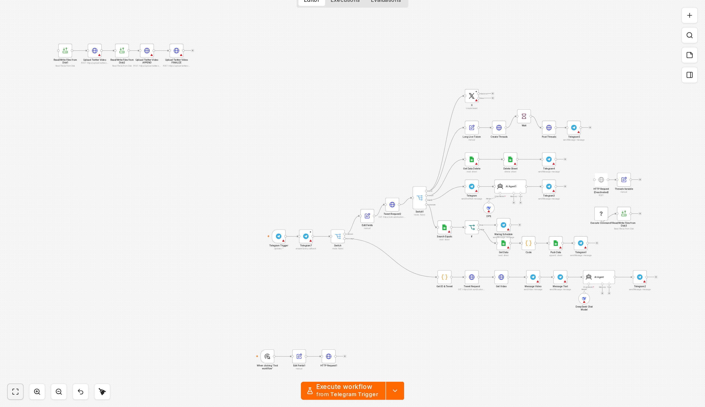

# n8n social publishing workflows

Recovered n8n workflows for three small publishing automations: a Telegram
intake that drafts and posts to X and Threads, a spreadsheet-queued video
publisher, and a scheduled page-change watcher that reports to Telegram.

This is a partial recovery. The graph, safe configuration, expressions and
reviewed JavaScript are included. Credentials and private values are replaced,
and two host-side helper scripts are not part of the package.

*n8n editor, sanitized demonstration copy; not a production execution. The
workflow was inactive and nothing was run.*

## Status

Recovered automation that requires configuration. The workflows imported once
into an isolated demo instance in the inactive state and were not executed. No
credential was created and no external API was called. Do not treat this package
as a working deployment or as end-to-end validation.

## What is included

- `workflows/` - three sanitized n8n workflow files, all with `active: false`.
- `screenshots/` - real editor captures from the isolated demo.
- `docs/diagrams/` - generated topology diagrams, useful when a capture is too
  dense to read.
- `docs/import-notes.md` - import steps, placeholders and required settings.
- `docs/screenshots.md` - what each capture shows and what it does not prove.
- `docs/validation.md` - checks performed, and checks that were not performed.

## Workflows

| File | Trigger | Main steps |
|---|---|---|
| `social-media-publishing.json` | Telegram message or callback | classify input, draft with a model, route by media type, publish text or upload video, record queue state |
| `scheduled-video-publishing.json` | Schedule | read pending rows, filter, upload and share video, create a post, confirm |
| `daily-reminder-agent.json` | Schedule | fetch pages, diff extracted text, ask a model for a message, deliver to Telegram |

Additional graph views:

- [Scheduled publishing](screenshots/02_overview_scheduled_publishing.png)
- [Change watcher](screenshots/03_overview_change_watcher.png)

The diagrams in `docs/diagrams/` are generated from the sanitized JSON. They are
not interface screenshots and do not show a running instance.

## Editor captures of key nodes

| Capture | Node | Purpose | Basis |
|---|---|---|---|
| [Telegram trigger](screenshots/04_node_telegram_trigger.png) | Telegram Trigger | Receive text, video and callback updates | Documented by node type and settings |
| [Agent prompt](screenshots/05_node_agent_prompt.png) | AI Agent | Rewrite the reference text under stored rules | Prompt is visible; the reason for two variants is inferred |
| [Queue code](screenshots/06_node_schedule_code.png) | Code | Find the first free publishing slot in the queue | Documented by the included code |
| [Media upload](screenshots/07_node_media_upload.png) | Upload Twitter Video | Start, append and finalize a chunked upload | Documented by the three requests |

All captures are labeled *n8n editor, sanitized demonstration copy; not a
production execution*. See `docs/screenshots.md` for the demonstration setup and
its limits.

Documentation is in English. Original Spanish prompts and spreadsheet keys are
retained where they define workflow behaviour; the editor captures show those
values rather than a translated mock.

## Setup

1. Import the three JSON files into a self-hosted n8n instance. The workflow IDs
   are generic placeholders; assign new IDs if you merge these files into
   another instance. This package has no sub-workflow references to remap.
2. Create credentials for Telegram, X media upload, Google Sheets, Google Drive
   and the chat model provider.
3. Recreate the queue spreadsheet with columns `Tweet`, `Link`, `Fecha` and
   `Estado`, then update the Google Sheets nodes.
4. Replace the placeholders listed in `docs/import-notes.md`. Public endpoints
   are kept; private values are not.
5. Provide the two excluded helper scripts, or disable the branches that call
   them.
6. Keep every workflow inactive until the configuration and side effects have
   been reviewed.

## Configuration

| Variable | Used by | Purpose |
|---|---|---|
| `TELEGRAM_CHAT_ID` | all flows | Operator chat for status and confirmations |
| `QUEUE_SHEET_ID` | publishing flows | Spreadsheet that holds the queue |
| `THREADS_ACCESS_TOKEN` | both publishers | Threads API access |
| `THREADS_CLIENT_SECRET` | social publishing | App secret used by the token refresh call |
| `THREADS_USER_ID` | both publishers | Threads account identifier |
| `SOCIAL_ACCOUNT_ID` | social publishing | Internal account label |
| `WORK_DIR` | all flows | Directory for downloaded media |
| `SCRIPTS_DIR` | command nodes | Directory holding the helper scripts |

The exports use `$env` expressions. On a hardened instance, environment access
from nodes may be blocked. Do not disable that restriction globally just to make
this package run: use credentials where possible, or enable environment access
only on a dedicated instance and only after reviewing every expression.

## Security

- Credential references and identified private tokens, identifiers and hosts
  were removed or replaced with configuration placeholders.
- JavaScript was reviewed before inclusion; prompt examples were replaced with
  synthetic text.
- The original instance token is not included. If the source instance still uses
  it, rotate it; never publish the original repository history.
- Publishing nodes have real side effects. The workflows are inactive here.

## Limitations

- Two helper scripts are excluded because their authorship and licence were not
  confirmed. The download and page-render branches cannot run without them.
- No end-to-end run, import into a live instance, or API test was performed.
- The editor captures show one n8n version; interface details may differ.
- Sheet schemas and credentials must be rebuilt.
- No licence is granted for this package.

## Provenance and dates

- Source: a private self-hosted n8n instance. Workflow metadata reports creation
  between June and July 2025, with later edits through October 2025.
- The sanitized copy and the demonstration review took place in October 2026.
- Import dates in the source repository are not development dates.

## Validation

`docs/validation.md` records the checks performed: JSON parsing, node and
connection integrity, inactive state, a single inactive import in an isolated
demo, zero executions, and screenshot metadata review. It also records what was
not validated.

## Licensing

No licence file is included and no licence for reuse is granted for this package.
Third-party services and n8n itself keep their own terms.

## Documentation

- [Import and configuration](docs/import-notes.md)
- [Editor screenshots](docs/screenshots.md)
- [Validation record](docs/validation.md)
